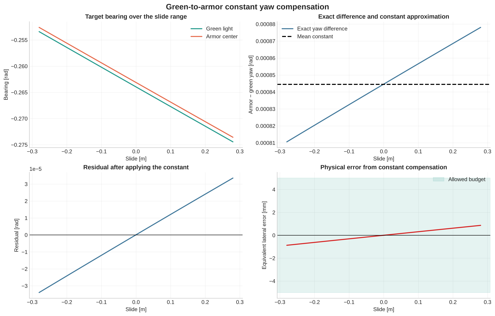
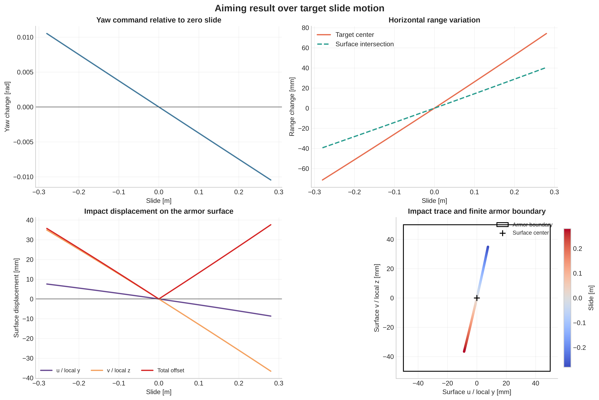
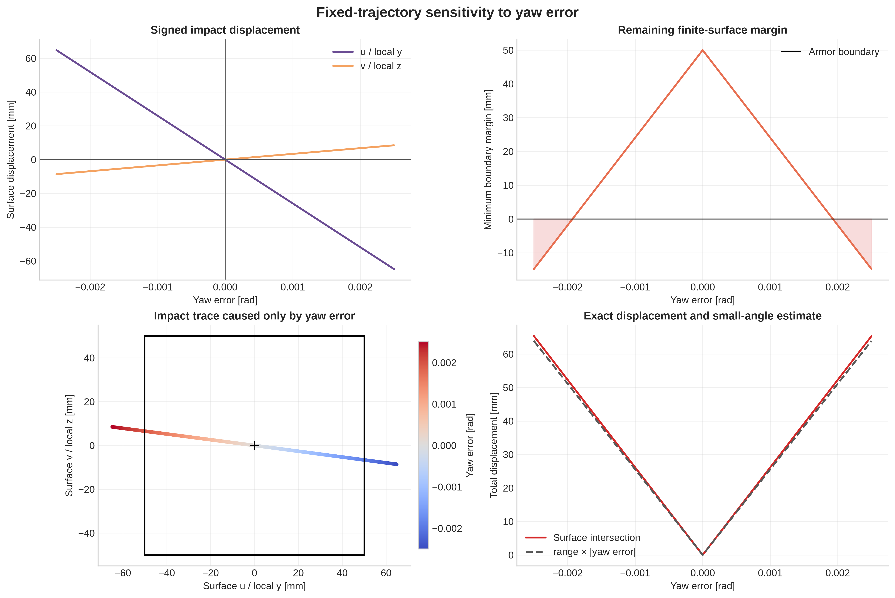
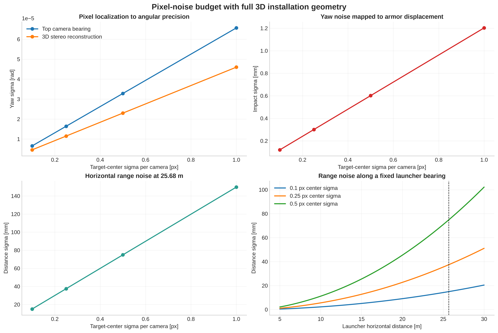

# 飞镖视觉瞄准几何与误差传播分析报告

分析日期：2026-11-18（Asia/Shanghai）。本报告由 `analysis/notebooks/target_impact_analysis.ipynb` 的当前执行结果生成。

## 1. 模型与计算约定

- 描述分支：`vertical-stereo`，提交 `a8e3090db5a6e843e777255f3c5fea8daaf6087c`；场景选择 `red` 方，对方基地。
- 滑轨范围：`[-0.28, 0.28] m`，共 561 个采样点。
- 装甲板采用模型中的 `100 × 100 mm` 矩形，未核验实物有效区域。
- 零位离轨点到装甲板中心的发射方向水平投影距离：`25.570246 m`。
- 第 2～4 节以 `dart_base_link` 为计算坐标系；其局部 z 在含横坡的场景中不等同于重力竖直方向。
- 轨迹为零位恰好经过装甲板中心的局部二次曲线。扫描滑轨时仅调整 yaw，保持发射俯仰和曲率；不包含空气阻力、飞行时间或真实发射动力学。
- 第 5 节使用 `launcher_frame` 中的三维重建和当前两台相机各自的 K/D；输出距离是相对发射架原点的水平距离。

## 2. 绿灯到装甲板的常量 yaw 补偿



| 指标 | 结果 |
| --- | --- |
| 候选常量补偿 / rad | 0.00084453 |
| 最小 / 最大 yaw 差值 / rad | 0.00081059 / 0.00087807 |
| 峰峰值 / rad | 0.00006748 |
| 常量残差 RMS / rad | 0.00001952 |
| 最大绝对残差 / rad | 0.00003393 |
| 最大等效水平横向误差 / mm | 0.872 |

在 `5.0 mm` 水平横向误差预算下，当前理想几何可以使用该常量。
这里检查的是角度残差对应的水平横向误差，不包含实物安装偏差；候选值未写入运行配置。

## 3. 滑轨运动下的固定俯仰与曲率轨迹



| 指标 | 结果 |
| --- | --- |
| 全行程 yaw 变化 / rad | 0.020975 |
| 零位 yaw 灵敏度 / (rad/m) | -0.037456 |
| du/ds / (mm/m) | -28.989 |
| dv/ds / (mm/m) | -127.756 |
| 最大板面偏移 / mm | 37.613 |
| 最大偏移对应滑轨位置 / m | 0.280 |
| 位于模型矩形内的采样比例 / % | 100.0 |

命中比例仅表示所采样的理想轨迹交点位于模型矩形内，不是实机发射成功率。

## 4. 固定目标的 yaw 误差传播



| 指标 | 结果 |
| --- | --- |
| du/dyaw / (mm/rad) | -25923.919 |
| dv/dyaw / (mm/rad) | 3410.803 |
| 0.0004 rad 引起的总位移 / mm | 10.458 |
| 采样得到的板内 yaw 区间 / rad | [-0.001920, 0.001920] |

工作点的局部总板面位移灵敏度为 `26147.335 mm/rad`。
按该局部线性化分配误差预算：

| 允许位移 / mm | 最大绝对 yaw 误差 / rad | 95% 分配对应 yaw σ / rad |
| --- | --- | --- |
| 2.5 | 0.00009561 | 0.00004878 |
| 5.0 | 0.00019122 | 0.00009756 |
| 10.0 | 0.00038245 | 0.00019513 |
| 20.0 | 0.00076490 | 0.00039025 |

95% 一列采用零均值高斯随机误差的 `1.96σ` 约定。标定、检测、机构及控制误差均需纳入实际总预算。

## 5. 上下相机的完整三维像素噪声传播



| 相机 | 光心 x / m | 光心 y / m | 光心 z / m | 光轴仰角 / ° |
| --- | --- | --- | --- | --- |
| top | 0.039452 | 0.000000 | 0.716387 | 2.000 |
| bottom | 0.289160 | 0.000000 | 0.317073 | 3.000 |

下光心减上光心：`[0.249708, 0.000000, -0.399314] m`，
总间距 `0.470963 m`。两台相机具有不同俯仰角；总间距不能直接作为平行双目公式中的有效基线。

零滑轨、装甲板几何对准 yaw 下，基地绿灯到发射架原点的水平距离为 `25.681747 m`，
两条视线交会锐角为 `0.905770°`：

| 相机 | fx / px | fy / px | 光轴深度 / m | 原图 u / px | 原图 v / px | 中心在图像内 |
| --- | --- | --- | --- | --- | --- | --- |
| top_camera | 15242.221 | 15221.322 | 25.6347 | 798.80 | 885.42 | True |
| bottom_camera | 15334.766 | 15318.636 | 25.3907 | 731.23 | 949.13 | True |

可见性仅覆盖该姿态下绿灯中心的原图投影，未检查轮廓、遮挡和全滑轨行程。

计算步骤为：K/D 投影到原图 → 独立像素扰动 → 五参数畸变逆解 → TF 旋转视线 →
两条空间射线最近点中点 → yaw、水平距离和高度差。对四个原始像素坐标作中心差分得到 J，
在各坐标独立且标准差相同的假设下使用 `Σ = σ_px² J Jᵀ`。

| 单坐标像素 σ / px | 上相机 bearing yaw σ / rad | 重建 yaw σ / rad | yaw 引起的板面 σ / mm | 水平距离 σ / mm | 高度 σ / mm |
| --- | --- | --- | --- | --- | --- |
| 0.10 | 0.00000657 | 0.00000460 | 0.120 | 14.98 | 0.28 |
| 0.25 | 0.00001641 | 0.00001150 | 0.301 | 37.45 | 0.70 |
| 0.50 | 0.00003283 | 0.00002300 | 0.601 | 74.90 | 1.40 |
| 1.00 | 0.00006566 | 0.00004600 | 1.203 | 149.80 | 2.80 |

板面 σ 仅映射 yaw 噪声，不含距离和高度误差对发射控制的作用。
距离扫描图固定发射架原点到目标的方向，改变目标沿该方向的距离，并逐点重新计算完整三维雅可比；
没有使用旧版 `Z = fB/disparity` 近似。

这些数字只覆盖像素随机噪声。K/D、安装外参、同步、机械振动和检测中心系统偏差均未计入；
当前外参仍来自描述模型，不能据此认定实机已经达到表中的精度。

## 6. 数值验证与复现

- 无噪声投影重建误差：`7.109e-15 m`。
- 最大中心线残差：`3.553e-15 m`。
- 最大板面法向残差：`9.127e-15 m`。
- 像素中心差分步长从 0.001 px 减半后，雅可比通过一致性检查。
- 像素传播辅助模块另有畸变/斜向安装重建、水平双目解析解和 Monte Carlo 回归测试。

在仓库根目录、ROS 和 analysis 环境就绪后运行：

```bash
source /opt/ros/jazzy/setup.bash
.venv/bin/python analysis/run_target_impact_analysis.py --export-report
.venv/bin/python -m unittest discover -s analysis -p test_stereo_precision.py -v
```

关键输入 SHA-256：

- `third_party/dart_description/urdf/modules/stereo_camera.xacro`：`6fcfb0af8cea57322eb0d72125e6eff83b46f936af68be457493922eb198a0ef`
- `analysis/stereo_precision.py`：`f7fbc6e96667b4cdcc48b7287eb25a4554b2ba0156e94758490473b6b91b3eb5`
- `src/dart_bringup/config/camera/calibration/00DA1923275.yaml`：`4090088f24a8ad1cb877ad28fef3f1ae1838a9fac8df7109f1e47e8befe99a4c`
- `src/dart_bringup/config/camera/calibration/00DA1923281.yaml`：`3cc62388f75746fa536b30a96052c3df22548bd7f740f1d356c3e1e38a9c0693`

## 7. 实机验证建议

在滑轨 -0.28、-0.14、0、0.14、0.28 m 处分别采集至少 200 帧，并覆盖典型光照。
记录上下相机像点、估计 yaw、水平距离、高度差及实际落点，检查均值、标准差、P95 和随位置变化。
另需标定距离/高度、发射力度与落点之间的关系，才能将视觉噪声转成最终落点预算。
