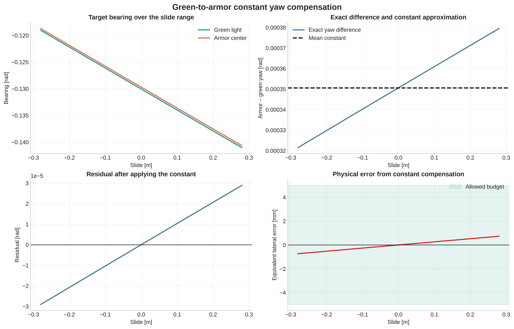
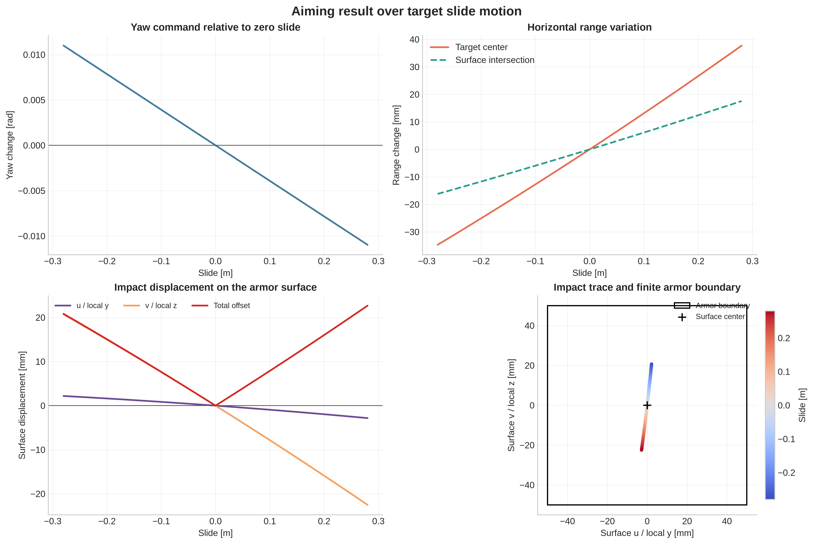
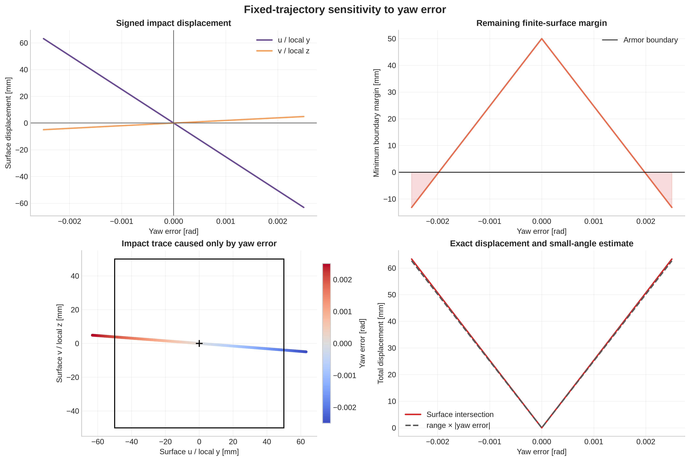
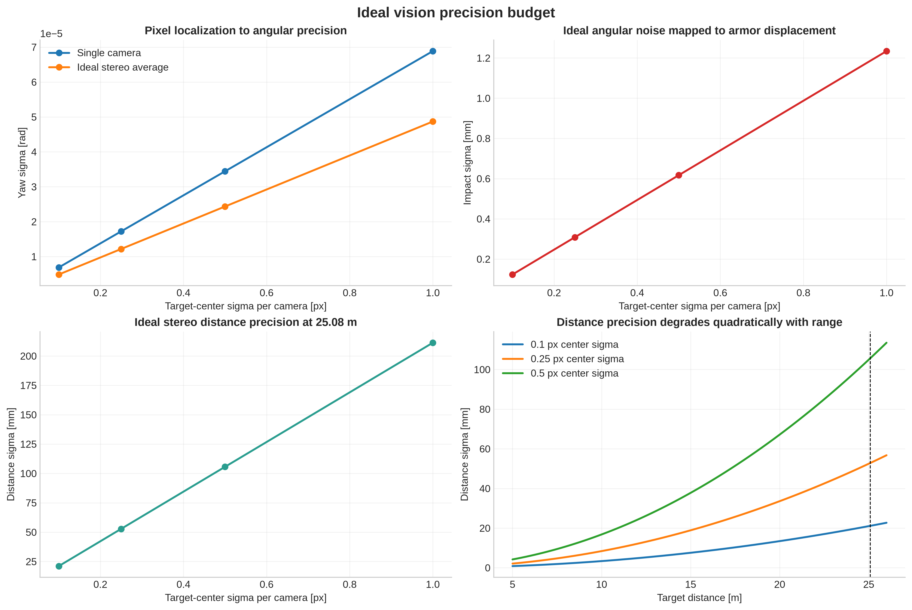

# 飞镖视觉瞄准几何与误差传播分析报告

**分析日期：** 2026-10-13  
**分析对象：** 绿灯、装甲板、滑轨目标及双目视觉测量链路  
**数据来源：** `target_impact_analysis.ipynb`、`third_party/dart_description` 中的目标几何模型及当前视觉参数

## 1. 分析目的

本报告围绕实际瞄准链路回答以下四个问题：

1. 绿灯方向与装甲板方向之间的 yaw 差值，能否用一个常量补偿；
2. 目标沿滑轨移动、飞镖轨迹保持不变时，落点如何变化；
3. 固定目标下，yaw 误差会在装甲板上产生多大位移；
4. 当前相机参数下，视觉角度精度和双目距离精度的理论量级是多少。

所有角度均使用弧度（rad），表面位移统一使用毫米（mm）。

## 2. 模型、数据与假设

本次计算采用以下条件：

- 滑轨位置范围：`[-0.28, 0.28] m`；
- 仿真采样点数：561；
- 参考目标距离：`25.083 m`；
- 装甲板有效区域：`100 mm × 100 mm`；
- 相机水平焦距：`fx = 14521.797 px`；
- 双目基线：`B = 0.29 m`；
- 飞镖轨迹在滑轨零位对准目标中心，之后保持不变；
- 目标几何按 URDF 理想值计算，不含加工、装配和标定误差。

轨迹模型用于比较几何变化和误差传播，并不包含空气阻力、初速度波动、飞行时间变化及控制器的距离—发射力度映射。因此，报告中的距离精度不能直接等价为最终落点精度。

## 3. 绿灯与装甲板 yaw 差值能否使用常量



在整个滑轨范围内，绿灯和装甲板中心的精确 yaw 差值为：

| 指标 | 结果 |
|---|---:|
| 建议常量补偿 | `0.00035058 rad` |
| 最小差值 | `0.000321 rad` |
| 最大差值 | `0.000380 rad` |
| 峰峰值 | `0.000058 rad` |
| 常量拟合残差 RMS | `0.000017 rad` |
| 最大绝对残差 | `0.000029 rad` |
| 最大等效装甲板位移 | `0.735 mm` |

结论：若为该项误差分配的表面位移预算为 `5 mm`，则使用单一常量 `0.00035058 rad` 是足够的。常量近似引入的最坏位移约为 `0.735 mm`，仅占该预算的约 15%。

该结论只覆盖理想几何导致的相对角度变化。实际部署时仍需通过图像测量检查固定安装偏差。若结构、相机外参或目标安装位置改变，应重新计算并标定该常量；若要求亚毫米级落点控制，则更适合使用随滑轨位置变化的查表或函数补偿。

## 4. 目标沿滑轨移动后的瞄准结果



在飞镖轨迹保持不变的情况下，目标沿滑轨移动会同时改变所需 yaw、目标距离和装甲板上的交点位置。

| 指标 | 结果 |
|---|---:|
| 全行程所需 yaw 变化范围 | `0.021962 rad` |
| 零位附近 yaw 灵敏度 | `-0.039219 rad/m` |
| 表面横向坐标灵敏度 `du/ds` | `-8.929 mm/m` |
| 表面纵向坐标灵敏度 `dv/ds` | `-77.182 mm/m` |
| 最大总落点偏移 | `22.686 mm` |
| 最大偏移对应滑轨位置 | `0.28 m` |
| 本模型中的装甲板命中率 | `100%` |

结果显示，滑轨移动对装甲板局部纵向坐标 `v` 的影响明显大于横向坐标 `u`。这意味着即使水平角度能够跟随目标，固定的发射轨迹仍会因目标姿态和距离的几何变化产生二维落点漂移。当前最大偏移仍在 `100 mm × 100 mm` 装甲板范围内，但 `22.686 mm` 已不可忽略。

工程上不应只用“是否命中”作为评价标准，还应监控落点距中心的偏差。若希望稳定落在中心附近，需要根据滑轨位置同步修正 yaw，并进一步建立距离或位置到俯仰角、发射力度的补偿关系。

## 5. 固定目标下 yaw 误差的影响



固定目标和固定轨迹下，改变 yaw 会使射线与装甲板平面的交点发生移动。在工作点附近，误差传播灵敏度为：

| 指标 | 结果 |
|---|---:|
| `du/d(yaw)` | `-25269.915 mm/rad` |
| `dv/d(yaw)` | `1967.965 mm/rad` |
| `0.0004 rad` yaw 误差对应总位移 | `10.138 mm` |
| 扫描范围内仍命中的 yaw 区间 | 约 `[-0.00197, 0.00197] rad` |

横向位移是主要分量。工作点附近可以使用线性近似：

```text
装甲板表面总位移 ≈ 25.35 m × |yaw 误差|
```

由此得到不同落点预算对应的 yaw 精度要求：

| 允许表面位移 | 最大绝对 yaw 误差 | 若按 95%（约 1.96σ）分配，对应 yaw 标准差 |
|---:|---:|---:|
| `2.5 mm` | `0.000099 rad` | `0.000050 rad` |
| `5 mm` | `0.000197 rad` | `0.000101 rad` |
| `10 mm` | `0.000395 rad` | `0.000201 rad` |
| `20 mm` | `0.000789 rad` | `0.000403 rad` |

因此，若希望 yaw 引起的落点偏差不超过 `10 mm`，总 yaw 误差应控制在约 `±0.000395 rad` 内；如果该要求是 95% 概率意义上的随机误差指标，则 yaw 标准差应不高于约 `0.000201 rad`。这里的“总 yaw 误差”应包含检测噪声、内外参误差、时间同步误差、机械振动以及控制执行误差，而不仅是算法输出的随机波动。

## 6. 视觉角度精度和距离精度



在理想针孔模型、左右相机独立同分布像素噪声的条件下，单目角度标准差近似为 `σ_yaw = σ_px / fx`；双目距离由视差计算，误差随距离平方增长。在 `25.083 m` 处，名义视差约为 `167.892 px`。

| 单相机中心定位标准差 | 单目 yaw 标准差 | 双目平均 yaw 标准差 | 表面位移标准差 | 双目距离标准差 |
|---:|---:|---:|---:|---:|
| `0.10 px` | `0.00000689 rad` | `0.00000487 rad` | `0.123 mm` | `21.1 mm` |
| `0.25 px` | `0.00001721 rad` | `0.00001217 rad` | `0.309 mm` | `52.8 mm` |
| `0.50 px` | `0.00003443 rad` | `0.00002435 rad` | `0.617 mm` | `105.6 mm` |
| `1.00 px` | `0.00006886 rad` | `0.00004870 rad` | `1.234 mm` | `211.3 mm` |

从理想随机噪声传播看，即使中心定位误差达到 `1 px`，角度噪声造成的表面位移标准差仍约为 `1.23 mm`，低于 `5 mm` 预算。然而，这只能说明相机内参提供了足够的理论角分辨能力，不能证明系统实际精度已经达到该水平。固定偏差通常不会被多帧平均消除，实际验收应重点检查：

- 左右相机内参和外参残差；
- 绿灯检测中心相对于真实几何中心的系统偏差；
- 时间同步和目标运动引入的角度偏差；
- 镜头畸变残差、曝光变化及机械振动；
- yaw 估计、控制指令与实际云台方向之间的闭环误差。

距离方面，在 `0.25 px` 理想中心定位标准差下，`25.083 m` 处的距离标准差约为 `52.8 mm`。由于双目深度误差随距离平方增长，远距离处应避免仅用固定的绝对距离阈值评价算法。当前项目尚未给出完整的“距离误差—发射力度—落点纵向误差”模型，因此暂时不能从 `52.8 mm` 距离误差直接推出装甲板上的最终位移。

## 7. 综合结论与建议

1. **绿灯到装甲板的 yaw 补偿可使用常量。** 当前几何下建议值为 `0.00035058 rad`，全行程最大等效残差约 `0.735 mm`，满足 `5 mm` 的分项预算。
2. **滑轨运动需要进入瞄准补偿。** 固定轨迹下最大落点偏移约 `22.686 mm`，虽仍命中装甲板，但会显著偏离中心，且主要表现为装甲板局部 `v` 方向漂移。
3. **建议以 `0.000395 rad` 作为 10 mm 落点预算对应的 yaw 最大误差参考。** 若按 95% 随机误差验收，yaw 标准差参考值为 `0.000201 rad`；更严格的 `5 mm` 预算对应 `0.000197 rad` 最大误差。
4. **理论像素精度不是系统精度。** 在 `0.25 px` 条件下理论角度和表面位移精度较充足，但仍必须通过真实静态目标实验测量均值、标准差、P95 和随滑轨位置的变化。
5. **距离精度需结合发射模型验收。** 建议补充距离、俯仰角、发射力度与纵向落点的标定数据，再把视觉距离误差转换为最终落点误差预算。

## 8. 建议的验证实验

在滑轨 `-0.28 m`、`-0.14 m`、`0 m`、`0.14 m`、`0.28 m` 五个位置分别采集不少于 200 帧数据，并记录左右相机像点、估计 yaw、估计距离和实际落点。每个位置至少在两种典型光照下重复测试。建议输出以下验收指标：

- 绿灯—装甲板 yaw 差值的均值、标准差和 P95；
- 常量补偿后的 yaw 残差随滑轨位置曲线；
- yaw 指令误差与装甲板实测横向位移的拟合斜率；
- 双目距离误差随距离的曲线；
- 最终落点的中心偏差、散布标准差、P95 和命中率。

这些实测结果可以验证本报告中的理想几何模型，并区分随机噪声与固定系统偏差，为最终误差预算和控制参数提供依据。
